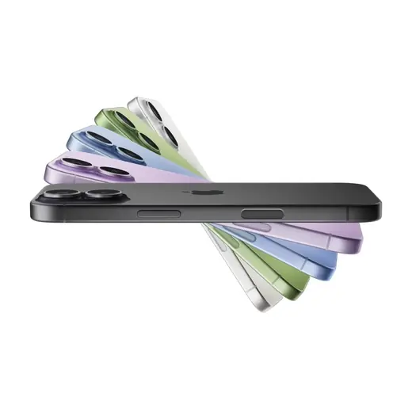
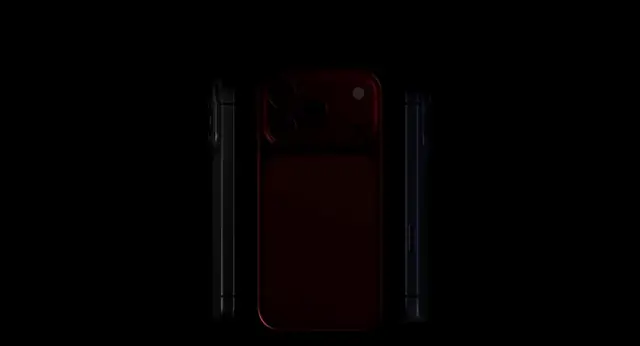
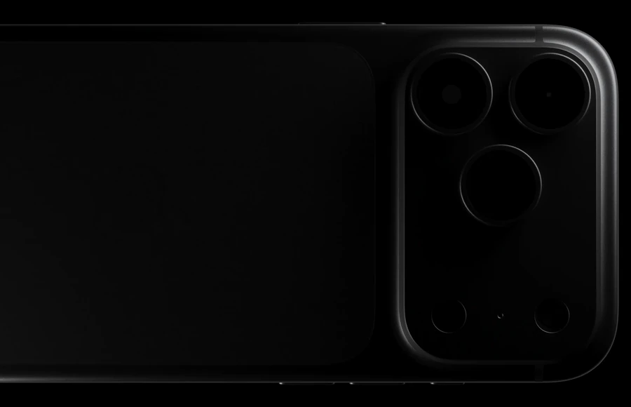
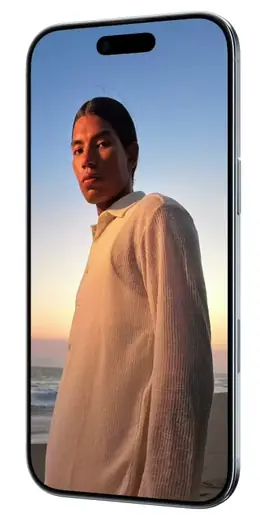

<div align="center">



<br>


<p>
  <strong>Uma loja que vende só iPhone, apresentada como a Apple apresenta: com o produto em movimento.</strong><br>
  Site vitrine estático, limpo e responsivo, feito como projeto de estudo.
</p>

</div>

---

## Em movimento

As animações do site são as mesmas que a Apple usa nas páginas oficiais dos aparelhos. Nada de imagens recortadas: cada modelo aparece girando, abrindo as cores ou mostrando de perto o que o diferencia.

<table>
  <tr>
    <td width="50%" align="center"><br><sub><b>iPhone 17</b>, as cinco cores em leque</sub></td>
    <td width="50%" align="center"><br><sub><b>iPhone 17 Pro</b>, os três acabamentos</sub></td>
  </tr>
  <tr>
    <td width="50%" align="center"><br><sub><b>iPhone 17 Pro</b>, o platô de câmeras</sub></td>
    <td width="50%" align="center"><br><sub><b>iPhone Air</b>, de frente para trás</sub></td>
  </tr>
</table>

## O que tem no site

| | |
|---|---|
| **iPhone 17 Pro e Pro Max** | Câmeras de 48 MP, zoom de 8x, unibody de alumínio e câmara de vapor, cada um com sua animação. |
| **iPhone Air** | A espessura de 5,64 mm em destaque, o aparelho girando e as quatro cores. |
| **iPhone 17** | Tela ProMotion de 120 Hz e Ceramic Shield 2. |
| **Escolha o seu** | Os quatro modelos com cores reais, preço e parcelamento em 12x. |
| **Comparativo** | Tela, chip, câmeras, zoom, estrutura, espessura e armazenamento lado a lado. |
| **Na loja** | Pagamento, troca do aparelho antigo, entrega e garantia. |

## Detalhes que fazem diferença

- **Vídeos em loop contínuo.** Começam a carregar antes de aparecer na tela e ficam rodando enquanto estão visíveis, sem travar nem parar no último quadro.
- **80% mais leves.** As animações foram convertidas para WebM (VP9): de 29,6 MB para 6,0 MB, sem perda visível. O MP4 original fica como reserva para navegadores sem WebM.
- **Versões próprias para celular.** Em telas pequenas, o site usa os recortes verticais que a Apple faz para cada animação.
- **Movimento discreto.** Entrada suave dos textos com GSAP e rolagem macia com Lenis. Quem ativa "reduzir movimento" no sistema vê tudo parado.
- **Visual sem excessos.** Branco, cinza e preto, fonte [Geist](https://vercel.com/font) e as cores oficiais de cada acabamento.

## Como rodar

Precisa só do [Node.js](https://nodejs.org) (18 ou mais recente). Não há dependências para instalar.

```bash
git clone https://github.com/gabrielnovaesdev/Iphone.git
cd Iphone
node src/server.mjs
```

Depois, abra **http://localhost:5173**. O servidor também aceita outra porta: `node src/server.mjs 8080`.

> [!NOTE]
> A fonte, o GSAP e o Lenis vêm de CDNs, então a página precisa de internet para aparecer completa. Sem conexão, o conteúdo continua legível, só sem as animações de entrada.

<details>
<summary><b>Gerar os vídeos WebM de novo</b></summary>

<br>

O script baixa cada animação listada em `src/js/data.js` e gera as versões WebM em `src/assets/video/`. Ele precisa do [ffmpeg](https://ffmpeg.org) com suporte a VP9.

```bash
FFMPEG=/caminho/para/ffmpeg node scripts/build-videos.mjs
```

Arquivos que já existem são pulados. Para refazer todos, acrescente `--force`.

</details>

## Estrutura

```text
src/
├── index.html            página única
├── server.mjs            servidor estático local (com suporte a Range para vídeo)
├── css/
│   ├── base.css          cores, tipografia, cabeçalho e botões
│   └── sections.css      seções de produto, compra, comparativo e loja
├── js/
│   ├── data.js           modelos, preços, especificações e endereços das animações
│   ├── ui.js             vídeos, cartões de compra e tabela comparativa
│   └── main.js           rolagem suave e animações de entrada
└── assets/video/         animações em WebM (desktop e celular)
scripts/
└── build-videos.mjs      download e conversão das animações para WebM
```

## Créditos e aviso

Projeto de estudo, sem fins comerciais. A loja Órbita, o endereço e as condições de venda são fictícios, e os preços são apenas referência.

As animações dos aparelhos são da Apple e foram usadas somente para fins de estudo. iPhone, iPhone Air e Apple são marcas registradas da Apple Inc. Este projeto não tem relação com a Apple.

<div align="center">
<br>
<sub>Feito por <a href="https://github.com/gabrielnovaesdev">@gabrielnovaesdev</a></sub>
</div>
